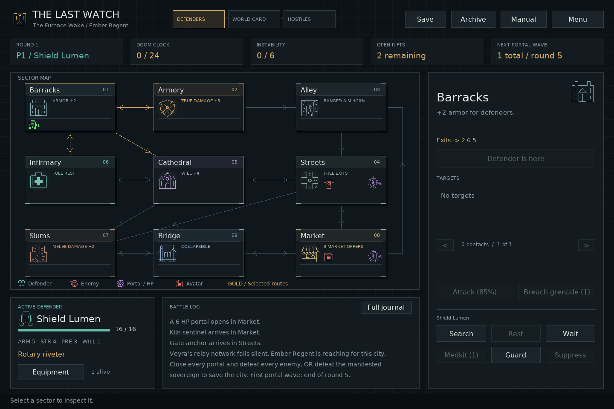
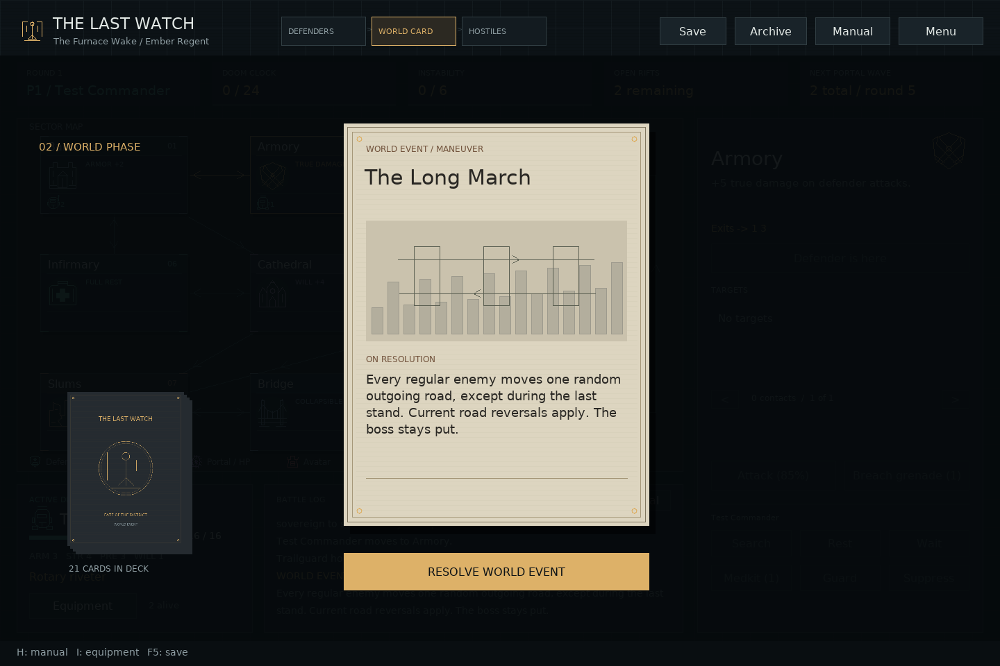
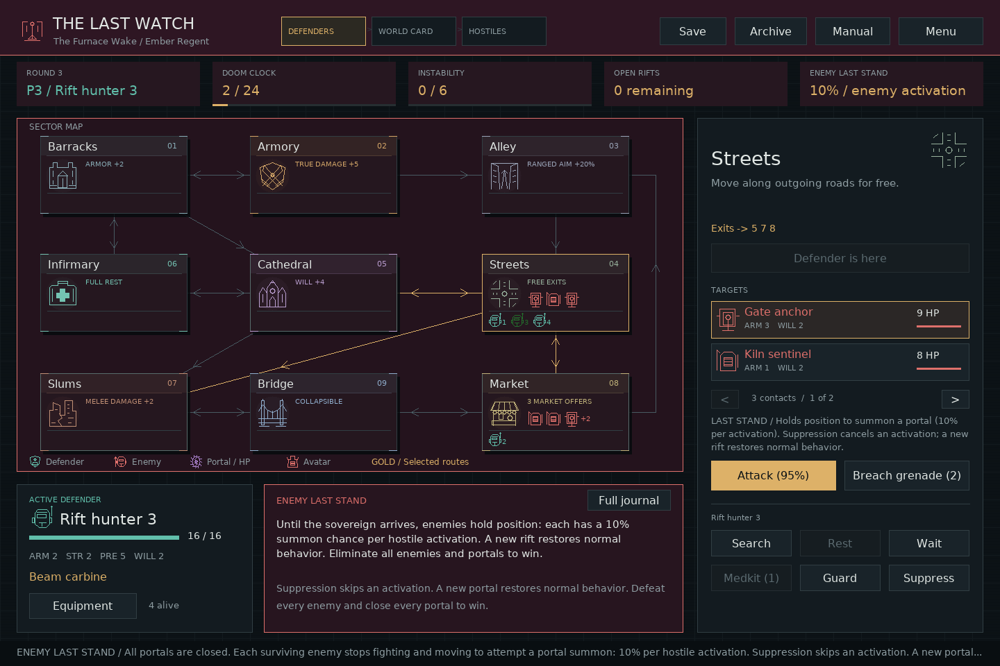

# Veyra — The Last Watch

Veyra is an industrial city cut off by a fractured relay network. Its last
defenders face four hostile sovereign intelligences from the Hollow, using
salvaged machinery and resonance weapons to seal the breaches. The setting,
names and procedural symbols now follow this original theme. See the
[systems review](docs/SYSTEMS.md) for the implemented mechanics and setting guide.

A playable, local C++17 strategy RPG. This README documents the current implementation; [README.txt](README.txt) provides a shorter plain-text guide. Lead one to four defenders across nine connected sectors, scavenge equipment, fight enemies, and seal breach portals before a Sovereign manifests. Win by closing every portal and defeating every enemy, or by slaying the manifested Sovereign.

The default interface is a **native SDL2 desktop GUI** with a clickable sector map, directed roads, animated world cards, separate turn phases, enemy intent previews, equipment, and campaign archives. Multiplayer is cooperative play on one computer. The terminal interface is also available; both frontends use the same C++ game engine and saves. Network multiplayer is not implemented.



## Play

Requires a C++17 compiler, CMake 3.16+, pkg-config, SDL2, FreeType, a local TrueType/OpenType font, and Bash for the launcher. The GUI draws its own map and illustrations; it does not need downloads, network access, or an account.

**On a new machine, install the dependencies before running the launcher.**
`play.sh` builds and launches the game; it does not install CMake or libraries.
See [Install dependencies](#install-dependencies) for the Debian/Ubuntu commands.
The required tools must be available in the terminal where you run the script.

```bash
bash ./play.sh
```

The launcher builds the game and opens the graphical title screen. Choose **New campaign** for boss and character selection, or **Quick deployment** to play immediately. The original `./ttrpg` entrypoint opens the GUI too.

For an immediate solo patrol:

```bash
./play.sh --quick --seed 42
```

The command-line `--quick` option starts **one** preset defender against Ember Regent. For a larger squad, launch the title screen normally and choose **1–4 players** above **Quick deployment**. The title-screen option deploys distinct presets with varied callsigns, and the lead preset rotates across deployments. A fixed seed makes random choices repeatable.

Once built, launch directly with `./build/ttrpg_gui` to skip the build step. The window resizes while preserving the layout.

For the terminal version, run `./play.sh --cli` (or add `--quick --seed 42`). This uses a separate `build-cli` directory and requires no SDL2 or FreeType.

[Title screen and Quick deployment](docs/title-screen.png) · [Active defender highlight](docs/active-defender.png)

The **Field manual** has ten clickable topics covering turns, combat, sector bonuses, Bridge collapse, recovery, enemies, and saving. Choose **Tutorial** on the title screen for guided practice before starting a campaign.

### Graphical controls

- The active defender's map icon blinks green during their turn, even when you inspect another sector. Low-health warnings remain on the defender panel.
- Click a sector to inspect it for free, then click **Move** to travel there. Road exits from Streets are free; other moves cost an action. Only permitted outgoing routes enable movement. Arrowheads show direction; gold highlights the selected sector's routes.
- Click a contact in the right panel, then **Attack (N%)** or **Breach grenade**. Target paging handles crowded sectors. Attacks require the target to share your defender's sector.
- **Defender orders** always act at the current defender's location, even while inspecting a different sector. Disabled controls prevent unavailable actions.
- Player and enemy attacks animate the actual attacker, target, strike, and result: ranged shots, melee slashes, psychic pulses, and grenade explosions, with damage, misses, or blocked hits.
- Boss manifestation turns the battlefield UI red. At one-third health or lower, the active defender panel flashes a red outline and shows a low-health warning. Enemy contacts display names without numeric identifiers.
- **Equipment** shows owned weapons and effective damage/accuracy. Equipping is free; **Trade** transfers items to another defender in the same sector. Inventory page arrows appear only when needed.
- **Guard** reduces incoming hits for the round. **Suppress** trades a ranged attack for denying an enemy activation.
- **Archive** saves or loads a named campaign file. **Menu** offers separate save-and-exit and **WITHOUT saving** choices for both title and desktop, plus optional autosave and animation speed. Closing the window opens this menu.
- The header tracks **Defenders → World card → Hostiles**. Brief phase banners dismiss automatically. Upkeep runs internally without an indicator, pause, or controls. Cards stay face-up until you resolve them. **Finish this animation** skips only the current automatic animation.
- Keys **1–9** inspect sectors; **I** opens equipment; **H** opens the manual; **J** opens the journal; **F5** saves; **Escape** closes dialogs or opens the pause menu. Scroll over the log to review earlier events.
- On setup, use the left/right arrows to cycle backward or forward through four presets and a custom defender. Custom builds have a point-allocation dialog and a starting-weapon selector; increment buttons disable when the next increase would exceed the 50-point budget. Callsigns and archive paths support text input and Ctrl+V paste; Ctrl+A clears a field. Hold Backspace to delete repeatedly.

The renderer finds common system fonts automatically. To select one explicitly, use `./play.sh --font /path/to/font.ttf` or the `TTRPG_FONT` environment variable. The GUI uses SDL2 and FreeType directly, without SDL_ttf.

## Guided tutorial and presentation

Use **Tutorial** on the title menu for 12 short lessons on a separate practice board. Practice movement, searching, equipment, attacks, grenades, guard, healing, cards and hostile phases. Previous/Next navigate lessons; **Exit tutorial** or Escape returns to the menu at any time, preserving your campaign and save.

Every defender order and enemy activation has a visible animation, including search scans, healing crosses, guard shields, hold-position dials, suppressed activations and last-stand rituals. Attacks show their actual result. Equipment changes briefly highlight the equipped row; the inventory pages through larger arsenals. Name fields support held Backspace, deleting whole UTF-8 characters.

The board uses a flat background with no decorative city boxes. Each sector has a distinct engraved landmark, color accent and reinforced tile border. Defender portraits, all 15 enemy types, portals and the four sovereigns have individual vector icons, shared by the map, contact list and action animations. Crowded tiles show up to three enemy portraits plus an overflow count, and separate markers for all four defenders, portals and the avatar. See the [complete icon sheet](docs/icons.png).

## Terminal orders

| Command | Effect |
| --- | --- |
| `move N` | Follow an outgoing route. Leaving Streets along a road is free. |
| `attack ID` | Attack a local enemy using its displayed `#ID`. |
| `portal` / `boss` | Attack that target in your current sector. |
| `search` | Spend an action to find a weapon or supply; sectors do not deplete. |
| `rest` | Heal 5 HP; in the Infirmary, fully heal and cure corrosion. |
| `medkit` | Consume a medkit to heal 8 HP and cure corrosion. |
| `grenade ID` | Deal 5 true damage to a local enemy (10 in Armory). |
| `grenade portal` | Instantly close a local portal, even through a Gate anchor shield. |
| `grenade boss` | Deal 5 true damage to the local boss (10 in Armory). |
| `guard` | Reduce each incoming physical/psychic hit by 3 before resistance for the rest of the round. |
| `suppress ID` | With a ranged weapon, roll its hit chance to make a local enemy skip its next activation; no damage. |
| `wait` | Spend your action holding position. |
| `trade P medkit` / `trade P grenade` / `trade P weapon N` | Give an item to player P in your sector for free. |
| `market` / `market N` | View three offers; choose offer 1–3 at Market for an action. |
| `collapse confirm` | Spend an action and a breach grenade while on Bridge to collapse it; see the permanent consequences below. |

`equip N` is free; `inventory` shows owned weapon numbers and their effective stats. `map`, `status`, `help`, and `rules` are also free. Invalid actions do not spend a turn, consume an item, or roll dice. Use numbers without the `#` prefix in commands.

## Saving

New campaigns write the `VEYRA_SAVE` header. Existing saves from the earlier
branding still load, with the same numeric IDs, player callsigns and random
state. Saving an imported campaign writes the new header. Older executables
cannot read that new header; keep a separate copy if you need to use them.

```text
save
save my patrol.sav
load my patrol.sav
quit
```

Both interfaces use `campaign.sav` in the working directory by default; the launcher uses the project directory. In the GUI, **Archive** selects a named slot; in the terminal, use `save PATH`. Paths may contain spaces; enter them without quotes in the GUI field or terminal prompt.

**GUI saving is manual by default.** Use **Save**, **F5**, or **Archive**, including between phases. The pause menu offers **Save and return to title**, **Return to title WITHOUT saving**, **Save and quit game**, and **Quit game WITHOUT saving**. A no-save exit discards the in-memory session and leaves the existing save untouched; Continue loads that saved state. Closing the window opens the pause menu. A failed save keeps the game running and displays the error.

Enable **Autosave** in the pause menu if preferred. It writes accepted orders, trades, equipment changes, and phase advances to the active slot. Quitting without saving cannot undo autosaves already written. The setting applies for the current application session. The journal contains this session's messages.
The terminal saves on `save`, quitting, or reaching the end of piped input, but does not autosave after each turn. Terminal debriefs exit the program. Starting another campaign in the same slot replaces it on the next save; use named slots to keep separate patrols.

```bash
./play.sh --load 'my patrol.sav'
```

Saves preserve the current player, turn phase, drawn card, enemy activation cursor, health, weapons, supplies, corrosion, guard/suppression, road reversals, enemies, portals, boss, sector closures, accuracy effects, Transport crew duration, event deck, and random-generator state. Loading a revealed but unresolved card returns to that same card without applying it twice. A resumed campaign continues the same random sequence on the same build/standard library. Writes use a temporary file before replacing the previous save; invalid loads leave the active game intact. The current save format is **version 6**; the loader also accepts version 1–5 campaigns. Destroyed bridges, permanently fallen defenders, and the current Market offers persist across saves. Living bosses from save versions 1–4 keep their health percentage when upgraded to the stronger stats; those campaigns with a dead boss become victories. Ongoing campaigns continue under the current rules; retired seals and wards are discarded. Previously completed victories stay completed. Existing decks gain the new cards when they next reshuffle. Saves are local text files, not a cross-version interchange format.

## Rules implemented

**Round order:** every living defender takes one action after a brief automatic banner, then one shared world card is drawn, flipped, and held for reading. Its effect applies only when you choose to resolve it. Existing corrosion ticks, enemies activate one at a time with intent previews, and the boss acts last. The game then advances doom by `1 + instability`, handles reinforcements and temporary effects internally, and returns control to the first surviving defender. There is no visible upkeep phase. The Lost Hours card adds another 2 doom. Player actions and individual enemy attacks do not advance doom on their own. The terminal resolves these phases automatically after the last defender order.



**Portals:** start with 6 HP, have no resistance, and cannot attack. There are two initial portals (four against Prism Oracle) and **two initial enemies per starting defender**: one construct of the selected patron and one Gate anchor per player character. Squads of 1/2/3/4 start with 2/4/6/8 enemies total, placed at the starting portals. Every fifth completed round, open portals summon **one enemy per living defender globally**: 1/2/3/4 surviving defenders produce 1/2/3/4 enemies total, regardless of portal count. Spawns are spread evenly across portals without defenders, with randomized ties. If all portals have defenders, the wave spreads across those portals instead; if none remain, no wave spawns. These reinforcements attack starting the following round. Waves use actual rounds, not the accelerated doom counter. Closing a portal grants a medkit to the living defender receiving its reward. **Instability never decreases from a player action or a portal closure; only a world event can lower it.**

**Victory:** close every portal **and** defeat every enemy, **or kill the manifested Sovereign**. Slaying the sovereign ends the campaign immediately, regardless of remaining enemies and portals. **Defeat:** reach instability 6, lose every defender permanently, or let eight further rounds finish with the manifested boss alive. Killing the sovereign takes victory priority even if the last defenders die in the same action.

**Enemy last stand:** before the sovereign appears, when no portals remain but enemies survive, the UI turns crimson and displays the ritual rules. Each surviving enemy holds position and attempts to summon instead of attacking or moving: **one 10% roll per hostile activation**. Suppression skips that activation. A successful summon opens a 6 HP portal in the summoner's sector, or another eligible sector if it occupies the protected Barracks or Infirmary. Normal behavior resumes immediately, including enemies that have not yet acted that phase. The sovereign’s arrival permanently disables last stand. The boss and regular enemies attack or move normally even without portals. Long March cannot move enemies during a last stand; a world card opening a portal also ends it. Clear the remaining enemies before another rift opens.



**Player combat:** weapons start at **80%** hit chance when their requirements are met exactly. Each **unmet requirement** subtracts **20 percentage points**, regardless of the size of the stat shortfall: one gives 60%, two give 40%. Each surplus point in the weapon's aiming stat adds **5 percentage points**, capped at **100%**. Melee uses Strength, ranged uses Precision, and psychic uses Will. Heavy weapon Strength is a requirement, not an additional accuracy bonus. A Strength 5 defender using a Strength 2 sword has 95% accuracy. Rolls use `d100 <= chance`. Guarded portals use this same weapon chance; unguarded portals are automatic hits. Enemies and the boss in that sector count as guards. **Gate anchors block weapon damage to their sector's portal until every local Anchor is defeated.** Suppression does not disable this shield. Breach grenades always hit and bypass it: they destroy portals, or deal 5 true damage to enemies and bosses (10 in Armory), ignoring resistance. All attacks target the attacker's own sector.

Physical damage is reduced by Armor; psychic damage is reduced by Will. Both can reduce damage to zero, and excess resistance never heals. Weapons have fixed base damage, modified by the sector bonuses below; character stats determine accuracy rather than bonus damage. True damage ignores both Armor and Will. Enemy damage gains the current instability value before resistance.

| Weapon | Damage | Accuracy | Requirement |
| --- | --- | --- | --- |
| Rivet pistol | 3 physical | Precision | Precision 2 |
| Beam carbine | 4 physical | Precision | Precision 2 |
| Rivet rifle | 5 physical | Precision | Precision 2 |
| Arc blade | 6 physical | Strength | Strength 2 |
| Rotary riveter | 7 physical | Precision | Strength 4 + Precision 2 |
| Resonance staff | 7 psychic | Will | Will 3 |
| Needle rifle | 10 physical | Precision | Precision 5 |
| Thermal cannon | 12 physical | Precision | Strength 4, Precision 3 |
| Pile maul | 11 physical | Strength | Strength 5 |
| Resonance glaive | 11 psychic | Will | Will 5 |

For example, Strength 2 / Precision 2 gives a rotary riveter 60%; Strength 2 / Precision 1 gives it 40%. Melee weapons do not require Precision. The resonance staff remains a psychic weapon when its Will requirement is unmet, with a 60% hit chance. Ashfall subtracts another 20 percentage points temporarily. Grenades and automatic portal hits are unaffected. Equipping is free.

Enemy attacks use `d20 + attack stat >= 12` (Strength for physical attacks, Will for psychic attacks; bosses add another 4), with natural 1 missing and natural 20 hitting. Blinding Flare subtracts 4 from enemy/boss rolls, equivalent to 20 percentage points away from the natural-roll limits.

**Recovery:** except for permanent deaths caused by Bridge collapse, at zero HP a defender immediately returns to the Infirmary, heals fully, loses corrosion, and adds 1 instability. They cannot be targeted again during that phase, even by enemies already at the Infirmary. Every enemy strike selects randomly from the remaining eligible players in its sector. Recovery protection ends at the round boundary, and the defender acts normally next round.

**Scavenging:** Search spends one action to find loot. There is no finite sector resource counter. Barracks favors rivet rifles, Armory offers military weapons, Cathedral offers staves and resonance glaives, and Infirmary supplies favor medkits. Other locations offer mixed loot. Duplicate weapons become supplies. Enemy kills have a 50% loot chance; each non-quiet world event has a 25% bonus supply chance. Quiet draws have no extra supply roll. Supplies cap at 99 each.

**Tactics:** Guard reduces each incoming non-corrosion hit by 3 before resistance for the rest of the round. Suppress requires an equipped ranged weapon and a successful roll using the equipped weapon's hit chance; it deals no damage, but makes the chosen local enemy skip its next activation. Suppression also prevents a last-stand ritual for that activation. Barracks and Infirmary remain protected from portals.

**Events:** each world draw has a **50% chance of A Moment of Silence**. Other draws use a shuffled deck of **22 meaningful events**, which cannot repeat until that deck is exhausted. Quiet draws leave the deck untouched. **No world card directly damages defenders.** Combat and existing corrosion remain dangerous during the separate hostile phase. Benefits and transport apply only to living defenders; events do not revive fallen characters.

| Card | Effect |
| --- | --- |
| A Moment of Silence | No additional board effect. |
| Relay Airlift | One random consumable per defender. |
| Signal Procession | Spawn a Breach tuner in Market. |
| Breach in the Veil | Open a portal in an eligible sector. |
| Twisting Streets | Reverse one-way roads for this world phase and the following round. |
| The Beacon Holds | Reduce instability by 1. |
| Lost Hours | Add 2 doom in addition to normal round progression. |
| Hunting Pack | Spawn the sovereign's hunter at a portal, or Slums if none remain. |
| Field Hospital | Heal all defenders 4 HP and cure corrosion. |
| Arsenal Unsealed | Give one defender a weapon; duplicates become supplies. |
| Supply Convoy | Give every defender one medkit. |
| The Long March | Move each regular enemy one random outgoing road, except during a last stand. |
| Anchor Deployment | Add an Anchor at a portal without one, if available. |
| Sovereign Emissary | Spawn a construct of the selected Sovereign in Slums. |
| Breach Collapse | Destroy one random portal. |
| Orbital Pinpoint | Destroy one random regular enemy. |
| Quarantine Cordon | Close one sector to entry through the following round; occupants may leave. |
| Emergency Teleport | Transport every defender to a different random open sector. |
| Ashfall | Reduce player weapon and suppression accuracy by 20 percentage points through the following round. |
| Blinding Flare | Apply -4 to enemy and boss attack rolls through the following round. |
| Purge the Streets | Destroy all regular enemies in one occupied sector; spare defenders and bosses. |
| Null Resonance | Destroy all portals; surviving enemies enter last stand only before the sovereign appears. |
| Transport crew | Through the next defender phase, each living defender may spend a move to fly to any sector except a destroyed Bridge, ignoring roads and temporary closures. |

**Map:** the original nine sectors and directional connections are preserved. Each sector lists only its **outgoing exits**. Some roads allow travel both ways; others are one-way. Entering a sector does not automatically allow you to return along the same road. Players, boss pathfinding, pursuing enemies, and movement events obey these directions. Transport crew is the player-only exception: its flights bypass roads and temporary closures, but never the destroyed Bridge. Twisting Streets temporarily reverses every one-way edge; reciprocal roads stay reciprocal. The displayed arrows and permitted moves update together. A Quarantine Cordon blocks incoming movement for all actors while allowing occupants to leave. Its sector is selected to preserve existing access between remaining open sectors, and Barracks/Infirmary never close. The Barracks and Infirmary never receive portals; enemies can enter them through movement events.

| Sector | Normal allowed destinations (before reversal) |
| --- | --- |
| 1 — Barracks | 2 Armory, 6 Infirmary, 5 Cathedral |
| 2 — Armory | 1 Barracks, 3 Alley |
| 3 — Alley | 4 Streets |
| 4 — Streets | 5 Cathedral, 7 Slums, 8 Market |
| 5 — Cathedral | 6 Infirmary, 7 Slums, 4 Streets |
| 6 — Infirmary | 1 Barracks, 5 Cathedral |
| 7 — Slums | 9 Bridge |
| 8 — Market | 4 Streets, 3 Alley, 9 Bridge |
| 9 — Bridge | 7 Slums, 8 Market |

For example, Armory → Alley is allowed, but Alley → Armory is not. Slums can only exit to Bridge, even when you entered from Cathedral or Streets. With normal roads and no temporary closures, all sectors are reachable until the Bridge is destroyed.

## Sector effects and trading

| Sector | Effect |
| --- | --- |
| Barracks | +2 armor for defenders. |
| Armory | +5 true damage on successful defender attacks, including grenades. |
| Alley | +20 percentage points to defender ranged accuracy, capped at 100%. |
| Streets | Move along a currently allowed outgoing road without spending an action. Non-road Transport flights still cost an action. |
| Cathedral | +4 Will for defenders, affecting psychic resistance and weapon accuracy. |
| Infirmary | Rest fully heals and cures corrosion. |
| Slums | All melee attacks, including enemy and boss physical attacks, deal +2 physical damage before armor. |
| Market | Choose one item from three distinct random offers for an action. Offers refresh at the start of every defender turn; viewing, trading, free movement, and loading do not reroll them. |
| Bridge | Spend a breach grenade while on the Bridge to destroy it permanently. |

### Bridge collapse

1. Stand on **Bridge** with a breach grenade. Choose **Collapse Bridge** and confirm. This spends one grenade and your action. The confirmation names every defender who will be lost. Throwing a grenade at an enemy or portal does not collapse the Bridge.
2. **If the sovereign is on Bridge at that moment**, it loses half its **current HP**, ignoring resistance, and moves to **Slums**. Damage rounds up: 56 HP becomes 28; 51 HP becomes 25. A sovereign in another sector takes no damage and does not move.
3. **Every defender on Bridge dies permanently, including the acting defender.** There is no Infirmary recovery or instability increase. All regular enemies there die, and local portals close.
4. **Bridge remains inaccessible for the rest of the campaign**, including during Transport crew. With normal roads, Slums has no exit after collapse. Road reversals, Emergency Teleport, or Transport crew can still provide ways out of Slums.

Turn order skips fallen defenders, and future portal waves scale to the survivors. Losing every defender ends the campaign unless the sovereign also dies, which wins immediately. A sovereign that manifests after an earlier collapse starts in Slums without taking collapse damage. Destroyed Bridge and permanent deaths persist across saves.

### Trading

open **Equipment → Trade**, choose a co-located living defender, then give a weapon, medkit, or grenade. Transfers are free. You must keep at least one weapon; duplicate weapons cannot transfer. Giving away your equipped weapon automatically equips a remaining one. Supplies transfer one at a time. Taking an already-owned Market weapon is disabled.

[Trading preview](docs/trade.png) · [Market offers](docs/market.png) · [Bridge warning](docs/bridge-warning.png) · [Bridge rules](docs/manual-bridge.png)

Bonuses apply only while an entity occupies the relevant sector; base character stats are unchanged. The sector map shows concise effect labels, and Equipment displays current damage and accuracy.

## Defenders and adversaries

| Defender | HP | Armor | Strength | Precision | Will | Starting weapon |
| --- | ---: | ---: | ---: | ---: | ---: | --- |
| Bulwark | 16 | 3 | 4 | 3 | 1 | Rotary riveter |
| Trailguard | 16 | 2 | 2 | 5 | 2 | Beam carbine |
| Resonant | 13 | 1 | 1 | 3 | 5 | Resonance staff |
| Duskblade | 16 | 2 | 3 | 3 | 4 | Arc blade |

Every defender also owns a rivet pistol and starts with one medkit and one grenade. Trailguards have an extra grenade. Custom characters spend up to 50 points, with stat cost `n*(n+1)/2`, Armor 0–4, Vitality 1–9, other stats 0–9, and HP `1 + 3*Vitality`. They select a starting rotary riveter, beam carbine, resonance staff, or arc blade, and also carry a rivet pistol and standard supplies.

| Enemy | Behavior and counterplay |
| --- | --- |
| Hollow scavenger | Basic local physical attacker. |
| Siege automaton | Heavier armor and damage; psychic attacks target its lower Will. |
| Signal leech | Psychic damage; high-Will defenders resist it. |
| Breach tuner | Holds position and attacks local defenders with psychic pulses. |
| Gate anchor | Shields local portals from weapons even while suppressed. Kill it first or use a grenade directly on the portal. Grenades deal 5 true damage to the Anchor (10 in Armory). |
| Wire stalker | Attacks locally or follows one outgoing road toward the closest defender. Cannot attack on a movement activation. |
| Rust drone | Damaging hits inflict two rounds of corrosion under any boss. Suppress, guard, or kill it before infection. |

The selected contact panel explains each enemy's tactic. Each campaign starts with a patron construct and a Gate anchor per defender. Each wave spawn has a 50% chance to be a Hollow scavenger, 30% to be a patron construct, and 20% to be a generic specialist.

| Patron | Followers |
| --- | --- |
| Ember Regent | Kiln sentinel: strong local melee; Cinder tracker: pursuing hunter with high Will. |
| Prism Oracle | Prism mote: psychic attacker with no Armor; Refraction crawler: pursuing psychic attacker. |
| Echo Weaver | Echo runner: lightly armored hunter; Harmonic prowler: tougher hunter. Both benefit from double attacks. |
| Rust Gardener | Rust carrier: armored infector; Orchard crawler: durable pursuing infector. |

| Boss | Doom limit | Distinct rule |
| --- | ---: | --- |
| Ember Regent | 24 | Boss gains 2 damage at or below half health. |
| Prism Oracle | 32 | Two extra initial portals; psychic boss attacks. |
| Echo Weaver | 28 | Every enemy and the boss strikes twice. |
| Rust Gardener | 30 | Damaging enemy/boss hits inflict two rounds of corrosion. |

Corrosion deals 1 damage per round, bypassing resistance. Repeated infections refresh its duration rather than stacking. Newly inflicted corrosion begins ticking next round. Medkits, Infirmary rest, recovery, and the Field Hospital card cure it.

A manifested boss starts at the Bridge, or Slums if the Bridge was already destroyed. If no eligible defender shares its sector, it moves one road toward the closest defender instead of attacking. Boss base HP is 50 for Ember Regent, 52 for Prism Oracle, 50 for Echo Weaver, and 60 for Rust Gardener, plus six HP per starting defender. Their base attacks deal 10, 10 psychic, 7 (twice), and 9 damage respectively, before instability and resistance. At 64 active enemies, further spawns instead add instability, bounding the board size.

## Build and verify

These instructions use Linux and Bash. Open a terminal in the project folder containing `CMakeLists.txt` and `play.sh` before running the build commands.

### Install dependencies

On Debian/Ubuntu:

```bash
sudo apt update
sudo apt install build-essential cmake pkg-config libsdl2-dev libfreetype6-dev fonts-dejavu-core python3
```

On other Linux distributions, install the equivalents: a C++17 compiler and build tools, CMake 3.16+, pkg-config, SDL2 development files, FreeType development files, and a TrueType/OpenType font. Python 3 is optional and enables the frontend integration tests. Installing dependencies needs network access; building and playing afterward does not.

Check that the build tools and GUI development libraries are visible:

```bash
cmake --version
g++ --version
pkg-config --modversion sdl2 freetype2
```

### Launcher troubleshooting

If the launcher reports:

```text
./play.sh: line 15: cmake: command not found
```

it cannot find CMake in your terminal's `PATH`. Line 15 configures the GUI build;
this error occurs before any game code is compiled. Install the dependencies
above, confirm `cmake --version` works, then retry `bash ./play.sh` from the
project folder. The terminal launcher also requires CMake.

If CMake instead reports that SDL2 or FreeType cannot be found, install
`pkg-config`, `libsdl2-dev`, and `libfreetype6-dev` on Debian/Ubuntu. Runtime
libraries alone are insufficient for compiling the GUI.

A build made with temporary tools in another environment does not install
these dependencies on your machine. No launcher edit is needed for a missing
CMake command.

### Build and launch the GUI

The simplest option builds and launches in one step:

```bash
bash ./play.sh
```

To configure, compile, and launch separately:

```bash
cmake -S . -B build -DCMAKE_BUILD_TYPE=Release -DBUILD_GUI=ON -DBUILD_TESTING=ON
cmake --build build --parallel
./build/ttrpg_gui
```

The GUI executable is `build/ttrpg_gui`; this configuration also builds the terminal executable at `build/ttrpg`. After source changes, rerun the build command. Run the executable directly when you only want to play.

If the GUI cannot find a font, supply a local font explicitly:

```bash
./build/ttrpg_gui --font /usr/share/fonts/truetype/dejavu/DejaVuSans.ttf
```

### Build and launch the terminal version

For a terminal-only build, SDL2, FreeType, pkg-config, and font packages are unnecessary. On Debian/Ubuntu, install `build-essential` and `cmake`, plus optional `python3` for integration tests.

```bash
cmake -S . -B build-cli -DCMAKE_BUILD_TYPE=Release -DBUILD_GUI=OFF -DBUILD_TESTING=ON
cmake --build build-cli --parallel
./build-cli/ttrpg
```

Alternatively, `bash ./play.sh --cli` performs these steps and launches the game. The separate build directory keeps GUI and terminal-only configurations independent.

### Run tests

After building:

```bash
ctest --test-dir build --output-on-failure
```

For the terminal-only configuration, use `ctest --test-dir build-cli --output-on-failure`. Use `-DBUILD_TESTING=OFF` during configuration if you only want the game executables.

The C++ suite covers damage/resistance, equipment requirements, map connectivity, creation validation, shared turn order, invalid-action atomicity, item use, repeatable scavenging, immediate recovery and target exclusion, portal waves, every world event, boss mechanics, clear-the-board and immediate boss-slaying victories, all loss conditions, phase-by-phase save continuation, legacy saves, road reversals, temporary sector closures, transport, accuracy modifiers, custom starting weapons, quick-deployment rotation, trading, Market offers, sector bonuses, Bridge collapse and permanent deaths, guard, suppression, enemy roles, last-stand summon odds and behavior, and absence of direct event damage. It also runs **800 seeded campaigns** across all four bosses and party sizes, checking invariants and save round trips through public gameplay actions. Bridge tests cover every sovereign both on and off the crossing, odd/even health, save persistence, and whole-squad sacrifices. These are regression and smoke tests, not a substitute for human balance testing.

If Python 3 is available, CTest also tests both frontends. Terminal tests cover setup, malformed commands, paths with spaces, failed loads, EOF, and a complete losing campaign. GUI tests use SDL's headless driver and the real mouse/text event handlers to exercise the 1–4 player Quick deployment selector, manual topic navigation, four-player setup, custom point validation, two-player turns, one-way movement rejection, equipment, target selection, attacks, grenade use, draw/flip/read/resolve stages, automatic defender banners, combat animations, last-stand rendering, optional autosave, unchanged save files after both no-save exits, named archives, saves during phases, failed saves/loads, menus, defeat, restart, resizing, and screenshot rendering. The game itself does not require Python.

### Headless preview and sanitizer checks

To capture a GUI preview without a desktop session:

```bash
SDL_VIDEODRIVER=dummy ./build/ttrpg_gui --quick --seed 42 --screenshot /tmp/last-watch.bmp
```

For memory and undefined-behavior checks with GCC/Clang:

```bash
cmake -S . -B build-sanitize -DCMAKE_BUILD_TYPE=Debug -DENABLE_SANITIZERS=ON
cmake --build build-sanitize --parallel
ctest --test-dir build-sanitize --output-on-failure
```

## Code layout

- `game.*`: campaign state, actions, phase resolution, events, spawning, rewards, endings, and saves.
- `entity.*`, `player.*`, `enemy.*`, `boss.*`: actors, stats, inventories, and definitions.
- `items.*`: weapon profiles and consumable names.
- `map.*`: fixed sectors and pathfinding.
- `main.cpp`: terminal setup menus, board, commands, and debrief.
- `gui/`: SDL2 window, FreeType text renderer, sector map, dialogs, mouse/keyboard controls, and GUI integration checks.
- `campaign_io.*`: shared atomic save-file writing and validated loading for both frontends.
- `tests/`: engine, terminal, and graphical integration tests.

Both frontends call the same engine; game rules are not duplicated in the GUI. This implementation includes AI-assisted code. Both READMEs describe the playable game rather than the earlier design plan.
